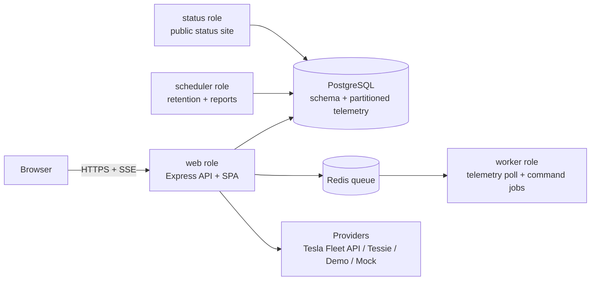

# VoltLink

**Self-hosted connected-vehicle platform** — telemetry, secure vehicle controls, drives & charging analytics, battery health, automations, notifications, fleet management, and a full status platform. One Docker Compose file, your own server, your data.

VoltLink is an original platform (comparable in scope to hosted telematics products) designed to run on a VPS or home server behind PostgreSQL and Redis. It talks to vehicles through a provider framework: the official Tesla Fleet API, the optional Tessie service, a deterministic DemoProvider for trying every feature without a car, and a scriptable MockProvider for tests.

## Feature overview

| Area | What you get |
| --- | --- |
| **Telemetry** | Live vehicle state (lock, doors, trunk/frunk, charge, climate, location), sleep-aware polling, telemetry history in partitioned tables |
| **Controls** | Command lifecycle `queued → submitted → accepted → confirmed` with `failed/rejected/unsupported/timed_out/canceled` outcomes, high-risk step-up auth, kill switches, rate limits |
| **Drives** | Auto-detected drives with route maps and replay, totals, CSV/JSON export |
| **Charging** | Sessions, electricity cost rules (flat, time-of-use, per-location), manual cost edits |
| **Battery** | Health estimate, efficiency, charging behavior analytics |
| **Automations** | Trigger + condition + action rules (notify, webhook, incident, report, vehicle command), cooldowns, dry-run, execution history |
| **Notifications** | 8 channels: in-app, email, web push, custom webhook + ntfy, Gotify, Discord, Teams; per-channel preferences |
| **Fleet** | Groups, drivers, departments, cost centers, assignments, maintenance records, fleet report |
| **Status platform** | Public status page (`/status`), RSS, SVG badge, subscriptions, incidents + maintenance windows, 16 monitored components |
| **Security** | Argon2id passwords, TOTP 2FA, WebAuthn passkeys, session revocation, envelope-encrypted credentials, CSRF, rate limits |
| **3D showroom** | Blender-generated GLB vehicles (5 distinct classes, LOD variants) rendered state-aware in WebGL with a procedural fallback |
| **Privacy** | Privacy zones that redact addresses in history, configurable retention, full export and permanent deletion |
| **Demo mode** | One click on the Providers page seeds 5 fictional vehicles with 30 days of realistic drives, charges, automations and status content |

## Quick start

```bash
# Clone
git clone https://github.com/Atvriders/voltlank.git && cd voltlank

# Generate secrets
export JWT_SECRET=$(openssl rand -hex 32)
export VL_MASTER_KEY=$(openssl rand -base64 32)
export PUBLIC_URL=http://localhost:3110

# Run (builds locally)
docker compose up -d

# Open http://localhost:3110 and register — the first account becomes owner.
# Enable demo mode on the Providers page to try every feature without a car.
```

Production (published image, no local build):

```bash
curl -fsSL https://raw.githubusercontent.com/Atvriders/voltlank/main/compose.production.yml -o compose.production.yml
# set JWT_SECRET, VL_MASTER_KEY, POSTGRES_PASSWORD, PUBLIC_URL
docker compose -f compose.production.yml up -d
```

## Architecture



Monorepo layout:

```
apps/api       Express 5 + Prisma + PostgreSQL (web/worker/scheduler/status roles)
apps/web       React 19 + Vite 7 SPA (5 themes, WebGL showroom, MapLibre map)
packages/shared Domain contracts shared by API and SPA
blender/       Headless Blender pipeline → original vehicle GLB assets
docs/          Full documentation suite
tests/e2e/     Playwright acceptance + WebGL asset tests
```

## Documentation

| | |
| --- | --- |
| [Quick start](docs/QUICK_START.md) · [Installation](docs/INSTALLATION.md) · [Docker Compose](docs/DOCKER_COMPOSE.md) · [Configuration](docs/CONFIGURATION.md) | Getting running |
| [Providers](docs/PROVIDERS.md) · [Tesla setup](docs/TESLA_SETUP.md) · [Tessie provider](docs/OPTIONAL_TESSIE_PROVIDER.md) · [Demo mode](docs/DEMO_MODE.md) | Connecting vehicles |
| [Vehicle controls](docs/VEHICLE_CONTROLS.md) · [Automations](docs/AUTOMATIONS.md) · [Notifications](docs/NOTIFICATIONS.md) | Everyday features |
| [Fleet management](docs/FLEET_MANAGEMENT.md) · [Status page](docs/STATUS_PAGE.md) · [Presentation mode](docs/PRESENTATION_MODE.md) | Operations |
| [Security](docs/SECURITY.md) · [Privacy](docs/PRIVACY.md) | Trust |
| [API reference](docs/API.md) · [OpenAPI spec](docs/openapi.json) | Developers |
| [Backup & restore](docs/BACKUP_RESTORE.md) · [Upgrading](docs/UPGRADING.md) · [Troubleshooting](docs/TROUBLESHOOTING.md) · [Deployment](docs/DEPLOYMENT.md) | Operations |
| [Development](docs/DEVELOPMENT.md) · [Testing](docs/TESTING.md) · [WebGL viewer](docs/WEBGL.md) · [Blender assets](docs/BLENDER_ASSETS.md) · [Asset licenses](docs/ASSET_LICENSES.md) | Contributing |
| [Known limitations](docs/KNOWN_LIMITATIONS.md) · [Changelog](CHANGELOG.md) | Reference |

## License

MIT — see [LICENSE](LICENSE). The Blender-generated vehicle assets are original works created for this project (see [docs/ASSET_LICENSES.md](docs/ASSET_LICENSES.md)).
